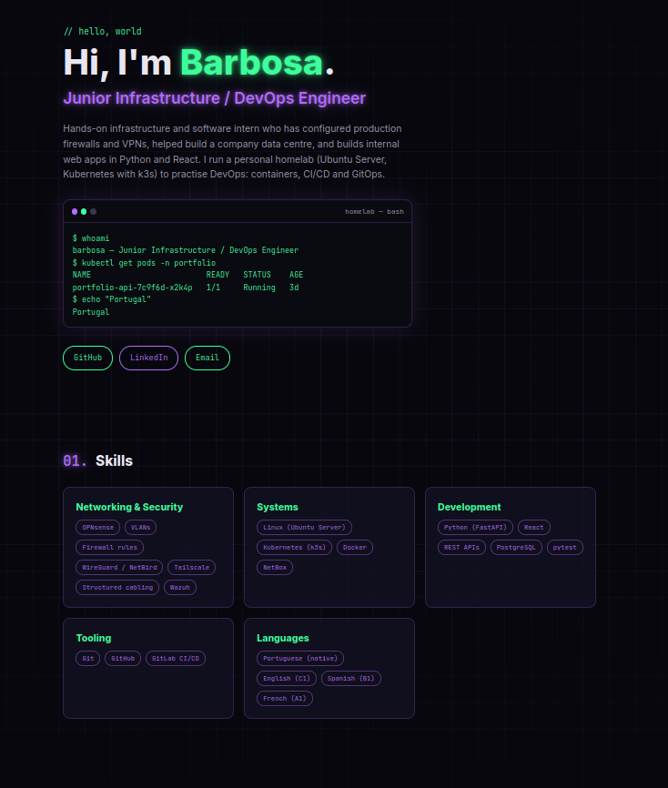

# Portfolio

My personal portfolio site, self-hosted on a homelab (Ubuntu Server laptop running k3s).
It is also my DevOps learning project: every stage adds one tool (Docker, Kubernetes, Ansible, CI, Argo CD).



## Stack

| Layer | Tool | Status |
|---|---|---|
| App | Python, FastAPI, plain HTML/CSS/JS | ✅ Stage 1 |
| Container | Docker | ⏳ Stage 2 |
| Server setup | Ansible | ⏳ Stage 3 |
| Orchestration | k3s (Kubernetes) | ⏳ Stage 4 |
| CI | GitHub Actions → GHCR | ⏳ Stage 5 |
| CD | Argo CD (GitOps) | ⏳ Stage 6 |

## Run it locally

```bash
python3 -m venv .venv
source .venv/bin/activate
pip install -r requirements-dev.txt
uvicorn app.main:app --reload --host 0.0.0.0 --port 8000
```

Open http://localhost:8000 (or `http://<server-ip>:8000` from another machine).
API docs are generated automatically at http://localhost:8000/docs.

## Run the tests

```bash
pytest
```

## API

| Endpoint | Returns |
|---|---|
| `GET /` | The portfolio page |
| `GET /health` | `{"status": "ok"}`, used by health checks |
| `GET /api/profile` | Name, title, summary, links |
| `GET /api/skills` | Skill groups |
| `GET /api/experience` | Jobs |
| `GET /api/projects` | Projects |

## Project layout

```
app/
  main.py        # FastAPI routes
  data.py        # all the portfolio content, edit this to change the site
  static/        # index.html, style.css, script.js
tests/           # pytest tests for the API
docs/            # notes for each stage
```

## Docs

- [Stage 1: the Python app](docs/stage-1-python-app.md)
